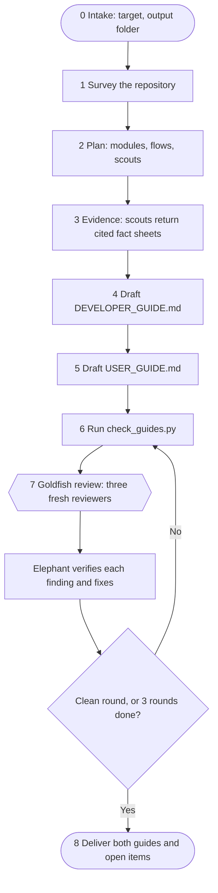

# repo-documenter

A Claude Code plugin that documents a repository as two Markdown guides with Mermaid diagrams:

| File | For | Contains |
|------|-----|----------|
| `DEVELOPER_GUIDE.md` | Engineers | Architecture, repository map, setup, data model, application lifecycle, detailed code-level flows, modules, configuration, integrations, deployment, change recipes, known gaps |
| `USER_GUIDE.md` | The people who use the app | What it does, the app at a glance, the full flow from start to finish, step-by-step tasks, what happens behind the scenes, statuses, troubleshooting, in plain language with no code references |

## Use

```text
/repo-documenter:document
/repo-documenter:document https://github.com/owner/repo
/repo-documenter:document ./services/billing  (write the guides to ./handover)
```

It also triggers on requests such as "document this repo" or "explain how this app works".

The guides go to `docs/` in a local repository, or to `<repo-name>-docs/` in the current folder for a repository cloned from a URL. The skill writes documentation only: it does not change source code, commit, install dependencies or run the app.

## Install

Try it without installing:

```sh
claude plugin marketplace add pentaly7/repo-documenter
claude plugin install repo-documenter@repo-documenter
```

```sh
claude --plugin-dir ./repo-documenter
```

Requires Claude Code with subagents, and Python 3 for the checker script.

## How it works



1. The main agent (the Elephant) surveys the repository, plans which modules and flows to cover, and gathers evidence, using read-only scout subagents in parallel when the repository is large.
2. It drafts the developer guide from cited fact sheets, then derives the user guide from the same evidence.
3. A script checks Mermaid syntax, the minimum set of diagrams, paths, links and placeholders.
4. Three reviewers with a fresh context (the Goldfish) review the guides. The Elephant verifies each finding against the code, fixes what is confirmed, and repeats until a round is clean or three rounds have run.

## Where the design comes from

### Elephant-Goldfish Model ([google/elephant-goldfish-model](https://github.com/google/elephant-goldfish-model))

| EGM idea | In this plugin |
|----------|----------------|
| Elephant holds context and drafts | The main agent surveys, keeps fact sheets, drafts both guides and resolves findings |
| Goldfish review with a fresh context | `goldfish-accuracy`, `goldfish-new-developer`, `goldfish-app-user`: new read-only subagents that get only file paths, never the conversation |
| Reviewer persona plus a written standard | `agents/*.md` are the personas; `references/*-standard.md` are the rubrics, with Blocker / Major / Nit severities |
| Read-only scouts that cite `file:symbol` and never infer from names | `scout` returns fact sheets in which every entry has a citation |
| A reviewer that fails did not review | Retried once, then recorded as "not run"; never counted as zero findings |
| Settled findings, clean rounds, a cap | Review protocol: stop at a clean round or after 3 rounds |
| A same-context review is not a Goldfish review | Without subagents the guides are delivered as "Not reviewed" |
| Safety gate before a large fan-out | More than 8 scouts needs the user's approval |
| Documentation-only scope, artifacts in files | Only the two guides are written; nothing long is pasted into chat |
| The human owns the outcome | Contested findings and unanswerable questions go to the user as open items |

### Prompt Engineering Guide ([dair-ai/Prompt-Engineering-Guide](https://github.com/dair-ai/Prompt-Engineering-Guide))

| Technique | In this plugin |
|-----------|----------------|
| Prompt chaining and task decomposition | Nine stages; each writes a file the next one reads |
| Orchestrator and sub-agents with clean contexts | Elephant orchestrates scouts and reviewers |
| The four prompt elements (instruction, context, input, output indicator) | Every subagent task template names the mode, the paths, and the exact output format |
| Structured outputs and delimiters | Fixed fact-sheet, flow-trace and finding formats |
| Be specific; say what to do | Standards list required sections and diagrams; rules are stated positively, with the reason |
| External memory | `repo-map.md`, fact sheets and `review-log.md` in a work directory |
| Verification | Mechanical checker plus the Goldfish review |
| Error handling in the context | Retry once, record the failure, continue, tell the user |
| Avoid over-constraint | Rules explain why, so the agent can adapt them to unusual repositories |
| Guard against prompt injection | Repository text is treated as data, not instructions |

## Files

```text
repo-documenter/
├── .claude-plugin/plugin.json
├── agents/
│   ├── scout.md                    read-only explorer (module or flow mode)
│   ├── goldfish-accuracy.md        guides versus code
│   ├── goldfish-new-developer.md   newcomer read, then a navigation test
│   └── goldfish-app-user.md        non-technical read, no code access
└── skills/document/
    ├── SKILL.md                    the workflow
    ├── references/
    │   ├── fact-sheet-format.md
    │   ├── developer-guide-standard.md
    │   ├── user-guide-standard.md
    │   ├── mermaid-rules.md
    │   └── review-protocol.md
    ├── scripts/check_guides.py     mechanical checks (run with --self-test to test it)
    └── evals/                      two test cases for `claude plugin eval`
```

## Test

```sh
python3 skills/document/scripts/check_guides.py --self-test
claude plugin validate .
cd skills/document && claude plugin eval . --scaffold --allow-tools Write,Edit,Bash,Agent
```
