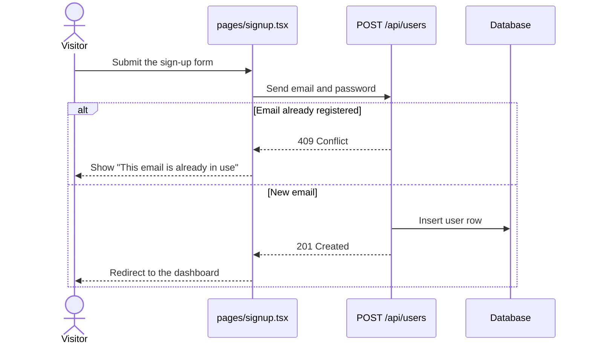
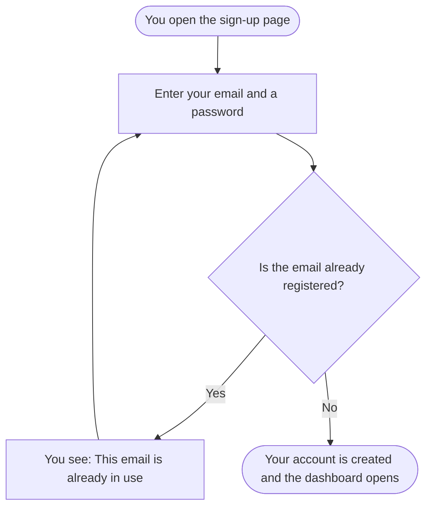

# Mermaid rules

Diagrams in the guides are fenced code blocks with the language `mermaid`. They must render on GitHub and in common Markdown viewers, so use plain, widely supported syntax.

## Pick the diagram by the question it answers

| The reader asks | Use | Notes |
|-----------------|-----|-------|
| What are the parts and how are they connected? | `flowchart LR` or `flowchart TD` | Group with `subgraph` (for example Client, Server, External) |
| What happens, in what order, between whom? | `sequenceDiagram` | Use `alt` / `opt` / `loop` for branches and repeats |
| What steps and decisions does a task have? | `flowchart TD` | Decisions as `{ }` diamonds with labelled exits |
| What data exists and how is it related? | `erDiagram` | Use `classDiagram` for in-memory types without storage |
| What statuses can a thing have and what moves it? | `stateDiagram-v2` | Label each transition with its cause |
| How does code get built and shipped? | `flowchart LR` | One node per pipeline stage |

## Syntax that renders

Most broken diagrams come from a small number of mistakes.

**Flowcharts**

- Start with `flowchart TD` or `flowchart LR`.
- Give nodes short ids of letters, digits and underscores, and put the text in a label: `checkout[Checkout page]`.
- Quote any label that contains punctuation such as `( ) [ ] { } : ; , / # & < >` or a quote mark: `api["POST /api/orders (JSON)"]`. An unquoted bracket inside a label ends the node early.
- Do not use `end` as a node id, and do not write a lowercase `end` as a whole label; it closes a subgraph. Use `finish`, or `End` inside quotes.
- Label arrows with pipes: `A -->|valid| B`. Quote the text if it has punctuation: `A -->|"status: paid"| B`.
- Every `subgraph` needs its own `end` line. Give it an id and a title: `subgraph ext["External services"]`.
- Use `<br/>` for a line break inside a quoted label.

**Sequence diagrams**

- Declare participants first, in the order they should appear: `participant web as Web app`, or `actor user as You`.
- Messages: `a->>b: text` for a call, `b-->>a: text` for a reply.
- Close every `alt`, `opt`, `loop`, `par` and `critical` with `end`.
- Avoid a semicolon in message text; write `and` or split the message. Use `#59;` only if a semicolon is essential.
- Use `Note over a,b: text` for a remark that is not a message.

**Entity-relationship diagrams**

- Relations: `USER ||--o{ ORDER : places`. The label after the colon is required.
- Attributes are `type name`, one per line, inside `ENTITY { }`. Use one-word types and names: `string email`.

**State diagrams**

- Start with `stateDiagram-v2`. Use `[*] --> Draft` for the start and `Done --> [*]` for the end.
- State ids are single words. For a longer name: `state "Waiting for payment" as waiting`.

**All diagrams**

- One diagram per code block. No Markdown inside the block.
- Comments start with `%%` on their own line.
- Do not rely on colors, custom themes or `classDef` styling for meaning; many viewers ignore them and dark mode changes them.

## Keep diagrams readable

- Aim for at most about 15 nodes in a developer diagram and 12 in a user diagram. When a diagram grows past that, split it: one overview, then one diagram per area.
- Use the same name for the same thing in every diagram and in the text.
- Flow direction: top-down for processes and decisions, left-to-right for architecture and pipelines.
- Put one sentence before each diagram that says what it shows. In the user guide, also follow it with a text walk-through.

## Examples

A developer flow:

````markdown

````

The same flow for an app user:

````markdown

````

## Checking

`scripts/check_guides.py` catches the common faults above: an unknown diagram type, unbalanced `end` lines, `end` used as a node, and unquoted brackets in labels. It does not render the diagram. If the Mermaid CLI (`mmdc`) is installed, rendering a doubtful diagram with it is the surest check.
