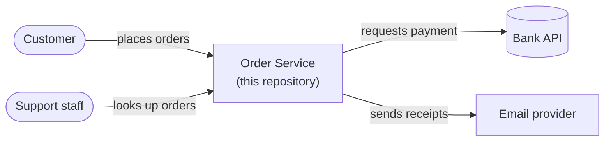
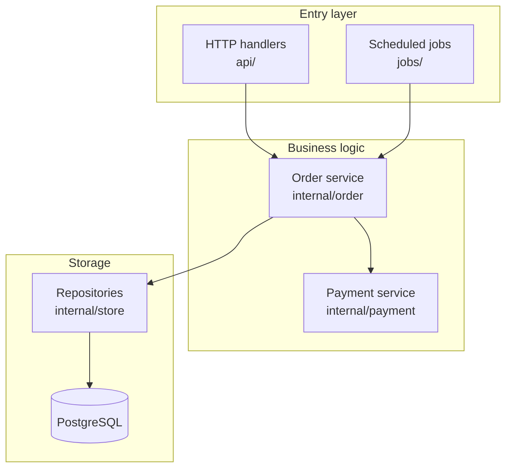
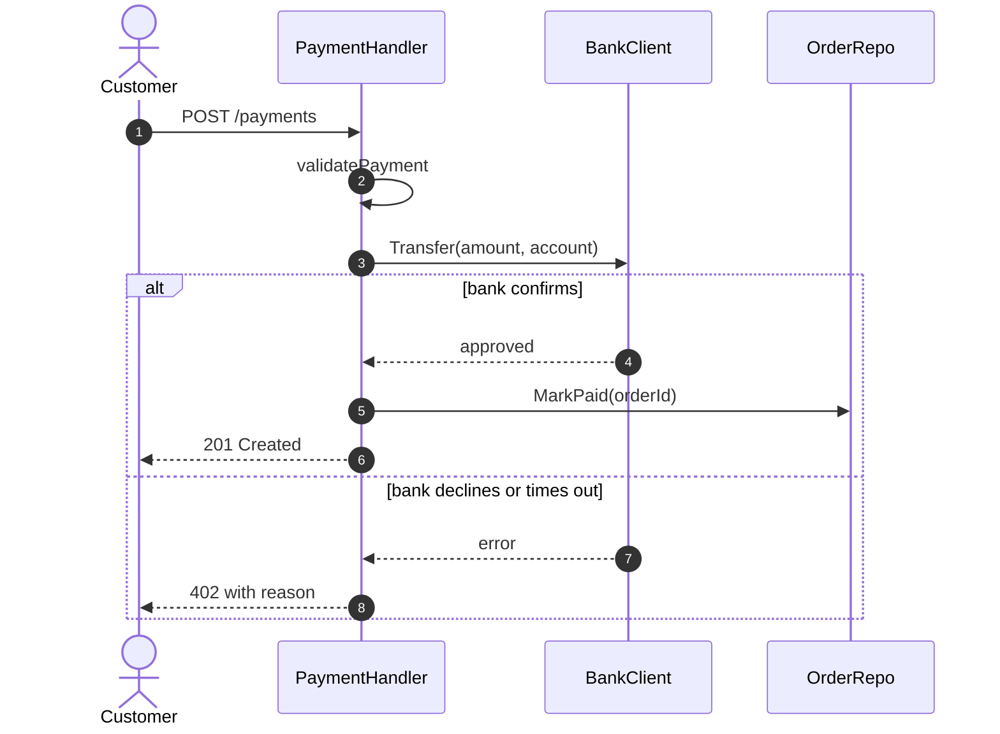
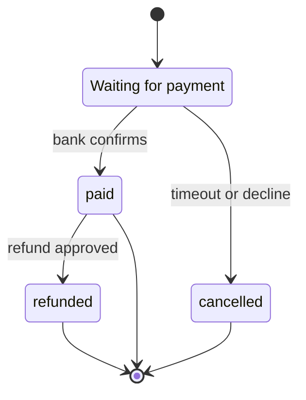
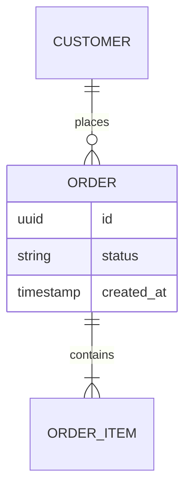

# Mermaid diagrams

## Which diagram answers which question

| Question the reader has | Diagram | Section | Drawn by |
|---|---|---|---|
| Who and what surrounds this system? | `flowchart` with the system as one box | 2.2 | Lead |
| What happens, roughly, start to finish? | `flowchart` with plain labels | 2.3 | Lead |
| What are the parts and how do they connect? | `flowchart` with `subgraph` groups | 4.2 | Lead |
| Who calls whom, in what order, for this flow? | `sequenceDiagram` | 5.x | Flow tracer |
| What decisions and branches are in this logic? | `flowchart` with decision diamonds | 5.x | Flow tracer |
| What is stored and how is it related? | `erDiagram` | 6.1 | Data scout |
| What statuses does a thing move through? | `stateDiagram-v2` | 6.2 | Data scout |
| How does code get to production? | `flowchart LR` | 10 | Ops scout |

Minimum set for a normal application: context, high-level flow, components, one
sequence diagram per traced flow, and a data model or state diagram when there is
persistent data or a status field. Add a diagram when it shows something prose
cannot; skip it when it would only repeat a three-item list.

## Rules that keep diagrams readable

- One idea per diagram and roughly 15 nodes or 10 participants at most. Split a
  crowded diagram into an overview and a detail diagram rather than shrinking it.
- Put one sentence above each diagram saying what it shows, and a short "reading
  this diagram" explanation below the first diagram of each type for readers who
  have never seen one.
- Diagrams in sections 1-3 use plain-language labels ("Checks the payment").
  Diagrams from section 4 on use real names (`PaymentHandler`).
- Use the same name for the same thing in every diagram and in the text.
- Show failure branches in sequence diagrams with `alt` / `else`, because the
  failure path is usually what the reader came to find.

## Rules that keep diagrams rendering

Mermaid fails on the whole diagram for one bad character, and the reader then sees
raw text. Check each diagram against this list:

- Start the block with ```` ```mermaid ```` and a valid type on the first line.
- Node IDs are simple words: letters, digits, underscores (`authSvc`, `db_main`).
  Never use `end`, `class`, `graph`, `subgraph` or `style` as an ID.
- Put every label containing spaces, punctuation, slashes, brackets or colons in
  double quotes: `api["POST /orders (v2)"]`. Replace double quotes inside labels
  with single quotes.
- Use `<br/>` for a line break inside a quoted label; no other HTML.
- In sequence diagrams, declare participants up front with short aliases
  (`participant DB as Database`), and keep message text free of semicolons and
  line breaks. Every `alt`, `opt`, `loop` and `par` needs its own `end`.
- In `erDiagram`, entity and attribute names have no spaces or dots; use
  `UPPER_SNAKE` entities and `type name` attribute lines.
- In `stateDiagram-v2`, state IDs have no spaces; give a display name with
  `state "Waiting for bank" as waiting`.
- Skip custom colours and themes unless asked; default styling works in both light
  and dark viewers.
- Keep to widely supported diagram types (flowchart, sequence, ER, state, class).
  Newer types fail on older renderers such as some GitLab and wiki versions.

## Patterns to adapt

System context:



Components:



One flow, with its failure path:



Lifecycle:



Data model:


